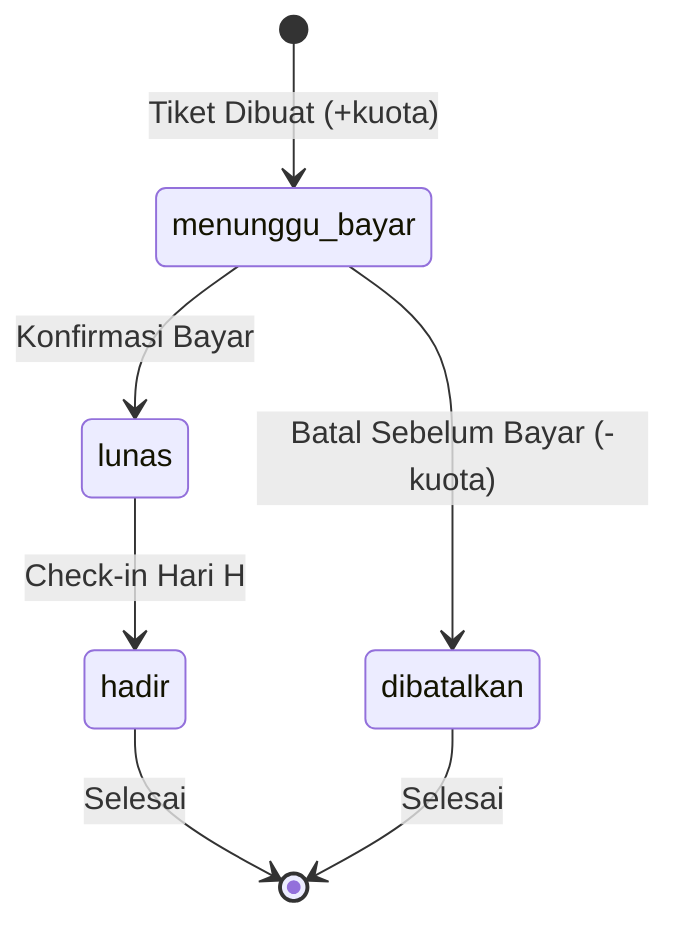

# Spesifikasi Desain: Karsa Tiket (Tiketing Event)

**Tanggal:** 2026-10-11  
**Status:** Disetujui (Approved)  
**Tujuan Dokumen:** Spesifikasi teknis dan desain antarmuka lengkap untuk implementasi aplikasi web Karsa Tiket berbasis React, Cloud Firestore, dan Netlify.

---

## 1. Ringkasan Eksekutif & Tujuan

Karsa Tiket adalah aplikasi web responsif (*mobile-first*) yang dibangun untuk mengelola operasional tiket komunitas kreatif (konser musik indie & workshop seni) yang dikelola oleh Laras. Aplikasi ini menggantikan pencatatan tiket manual berbasis spreadsheet yang rentan terhadap masalah overbooking, status pembayaran simpang siur, dan kesalahan rekonsiliasi finansial.

Pada lingkup Tugas Mandiri Sesi 3, aplikasi disederhanakan menjadi **satu peran latihan terpadu** (menggabungkan peran Penyelenggara dan Panitia) untuk fokus pada keandalan operasi CRUD, validasi data, kepatuhan batas kuota, dan integritas relasional Firestore.

---

## 2. Arsitektur Sistem & Struktur Direktori

Aplikasi dibangun menggunakan **React (Vite)** dengan pendekatan **Modular Feature-based Architecture with Clean Service Layer**. Antarmuka dipisahkan secara tegas dari pemanggilan langsung Firestore SDK untuk menjaga modularitas, kemudahan pengujian, dan keterbacaan kode.

### Struktur Direktori Proyek

```text
karsa-tiket/
├── public/
├── src/
│   ├── assets/              # Logo Karsa Tiket, ikon SVG, ilustrasi empty state
│   ├── components/          # Komponen UI Reusable (Design System)
│   │   ├── common/          # BottomNav, TopNavbar, Button, Modal, ConfirmDialog, Toast, Skeleton, Badge, StatCard
│   │   └── forms/           # FormField, SelectInput, DatePicker, CurrencyInput
│   ├── contexts/            # Global context (ToastNotificationContext)
│   ├── features/            # Modul berbasis fitur
│   │   ├── event/           # EventList, EventCard, EventFormModal
│   │   ├── pembeli/         # PembeliList, PembeliTable, PembeliFormModal, PembeliSearch
│   │   ├── tiket/           # TiketList, TiketCard, TiketTabs, TiketCreateModal, TiketStatusAction
│   │   └── rekap/           # RekapView, RekapMetrics, RekapProgressBar, RekapStatusBreakdown, RekapTiketTable
│   ├── services/            # Lapisan Firestore Modular SDK (Pure Business Logic)
│   │   ├── firebase.js      # Inisialisasi Firebase App & Firestore instance
│   │   ├── eventService.js  # CRUD Event & validasi kuota
│   │   ├── pembeliService.js# CRUD Pembeli, sanitasi WA (628xxx), proteksi delete aktif
│   │   ├── tiketService.js  # runTransaction create tiket, transisi status ketat, pengembalian kuota
│   │   └── rekapService.js  # Perhitungan metrik finansial & agregasi status
│   ├── utils/               # Formatter (Rupiah currency, tanggal ID, nomor WA) & validator
│   ├── styles/              # Token Design System Sesi 3 (CSS variables)
│   ├── App.jsx              # Routing/Tab navigasi 4 modul utama (Event, Pembeli, Tiket, Rekap)
│   └── main.jsx
├── docs/
│   └── superpowers/
│       └── specs/
│           └── 2026-10-11-karsa-tiket-design.md
├── firestore.rules          # Aturan keamanan Cloud Firestore
├── package.json
└── vite.config.js
```

---

## 3. Skema Data & Model Koleksi Firestore

### 3.1 Koleksi `event`
* **Document ID**: Auto-generated (`addDoc`)
* **Field**:
  * `nama` (string, wajib, min 3 karakter): Nama acara/workshop/konser.
  * `tanggal` (string YYYY-MM-DD, wajib): Tanggal pelaksanaan acara.
  * `lokasi` (string, wajib): Lokasi acara/venue.
  * `harga` (number, wajib, min 0): Harga satuan per lembar tiket (Rp).
  * `kuota` (number, wajib, min 1): Batas maksimal kapasitas tiket yang disediakan.
  * `tiket_terjual` (number, default 0): Jumlah akumulasi tiket yang telah dipesan.
  * `dibuat_pada` (serverTimestamp): Waktu pembuatan dokumen event.

### 3.2 Koleksi `pembeli`
* **Document ID**: `noWhatsapp` ternormalisasi (string standar, contoh: `"6281234567890"`).
* **Field**:
  * `nama` (string, wajib, min 2 karakter): Nama lengkap pembeli.
  * `noWhatsapp` (string, wajib, unik): Nomor WhatsApp yang telah dibersihkan dan dinormalisasi.
  * `email` (string, wajib, validasi format `@`): Alamat email pembeli.
  * `dibuat_pada` (serverTimestamp): Waktu pendaftaran pembeli.

### 3.3 Koleksi `tiket`
* **Document ID**: Auto-generated (`addDoc` / `doc(collection(db, 'tiket'))`)
* **Field**:
  * `event_id` (string, wajib): Referensi ID dokumen event.
  * `event_nama` (string snapshot): Nama event saat pembelian dilakukan.
  * `pembeli_id` (string, wajib): Nomor WhatsApp pembeli.
  * `pembeli_nama` (string snapshot): Nama pembeli saat pembelian dilakukan.
  * `jumlah` (number, wajib, 1 sampai 5): Jumlah lembar tiket yang dibeli.
  * `harga_satuan` (number snapshot): Harga per lembar tiket saat pembelian dibuat.
  * `total_harga` (number): Hasil perkalian `harga_satuan` * `jumlah`.
  * `status` (string, enum: `"menunggu_bayar"`, `"lunas"`, `"hadir"`, `"dibatalkan"`): Status tiket.
  * `dibuat_pada` (serverTimestamp): Waktu pencatatan pesanan tiket.

---

## 4. Logika Bisnis & Alur Transaksi Data

### 4.1 Pembuatan Tiket Atomik (`runTransaction` Anti-Overbooking)
Setiap transaksi pembuatan tiket wajib dijalankan dalam `runTransaction` Firestore untuk menjamin konsistensi kuota:
1. Membaca dokumen event terkait di dalam transaksi.
2. Menghitung sisa kuota: `sisa_kuota = event.kuota - event.tiket_terjual`.
3. Memverifikasi: Jika `jumlah > sisa_kuota`, gagalkan transaksi dengan pesan kesalahan ramah: *"Kuota tidak mencukupi (sisa kuota: X)"*.
4. Menulis dokumen baru pada koleksi `tiket` dengan status awal `menunggu_bayar`.
5. Memperbarui dokumen event dengan menambah `tiket_terjual: event.tiket_terjual + jumlah`.

### 4.2 Matriks Transisi Status Tiket (Ketat Sesuai PRD)
Perubahan status tiket mengikuti aturan mesin status (*State Machine*) deterministik:
* `menunggu_bayar` $\rightarrow$ `lunas`: Pembayaran telah diverifikasi oleh panitia.
* `menunggu_bayar` $\rightarrow$ `dibatalkan`: Pembatalan sebelum bayar. Dilakukan via `runTransaction` untuk mengembalikan kuota event (`tiket_terjual` berkurang sebesar `jumlah`).
* `lunas` $\rightarrow$ `hadir`: Peserta hadir di lokasi acara (*check-in*).
* Tiket berstatus `lunas` **TIDAK BISA** dibatalkan (sesuai matriks ketat PRD).
* Tiket berstatus `hadir` dan `dibatalkan` bersifat final dan tidak dapat diubah lagi.



### 4.3 Proteksi Integritas Relasional (Prevent Delete)
* **Hapus Event**: Ditolak jika `tiket_terjual > 0` atau terdapat data tiket terkait. Pengguna menerima peringatan dialog: *"Event tidak dapat dihapus karena sudah memiliki tiket terdaftar."*
* **Hapus Pembeli**: Ditolak jika pembeli masih memiliki tiket aktif berstatus `menunggu_bayar`, `lunas`, atau `hadir`.

### 4.4 Modul Rekap & Rekonsiliasi Finansial
* Rekap dihitung per event terpilih.
* **Pendapatan Bersih**: Akumulasi `total_harga` hanya dari tiket berstatus `lunas` dan `hadir`.
* Tiket `menunggu_bayar` dan `dibatalkan` tidak dihitung ke dalam pendapatan.
* **Persentase Keterisian**: Visualisasi progress bar `(tiket_terjual / kuota) * 100%`.
* **Breakdown Status**: Menampilkan metrik terpisah untuk 4 status (`menunggu_bayar`, `lunas`, `hadir`, `dibatalkan`).

---

## 5. Desain Antarmuka & Sistem Visual (Design System)

### 5.1 Tipografi
* **Font Utama Antarmuka**: **`Plus Jakarta Sans`** (Google Fonts).
* **Fallback**: `Inter, system-ui, -apple-system, sans-serif`.
* **Skala Tipografi**:
  * H1 (Title / Rekap Big Metric): 24px–28px, Bold (700)
  * H2 (Card Title / Subtitle): 16px–18px, SemiBold (600)
  * Body Text: 14px, Regular (400)
  * Caption / Status Label: 12px, Medium (500)

### 5.2 Palet Warna: Rose Quartz & Serenity Edition

| Kategori Token | Nama Token | Nilai Hex | Penggunaan Antarmuka |
| :--- | :--- | :--- | :--- |
| **Brand Primary** | `--color-primary` | `#557BB5` | Tombol utama, tab aktif, ikon fokus (Serenity Deep) |
| **Brand Hover** | `--color-primary-hover` | `#3F6399` | Efek hover/tekan tombol |
| **Brand Accent** | `--color-accent` | `#F7CAC9` | Rose Quartz lembut untuk highlight dan border kartu |
| **Accent Dark** | `--color-accent-dark` | `#D4708A` | Aksen kontras untuk badge khusus |
| **Brand Gradient** | `--gradient-brand` | `linear-gradient(135deg, #F7CAC9 0%, #92A8D1 100%)` | Header bar atas, tiket border highlight |
| **Background** | `--color-bg` | `#F8F9FD` | Latar belakang halaman aplikasi |
| **Surface** | `--color-surface` | `#FFFFFF` | Latar belakang kartu, modal dialog |
| **Border** | `--color-border` | `#E4E8F2` | Garis tepi kartu dan input field |
| **Text Primary** | `--color-text-main` | `#1E2538` | Teks utama dengan kontras tinggi (WCAG AA) |
| **Text Muted** | `--color-text-muted` | `#687289` | Teks pendukung, tanggal, nomor WhatsApp |

#### Semantic Status Pills
* **`menunggu_bayar`**: Teks `#B45309`, Latar `#FEF3C7`, Border `#FDE68A` (Amber)
* **`lunas`**: Teks `#047857`, Latar `#D1FAE5`, Border `#A7F3D0` (Emerald)
* **`hadir`**: Teks `#4355B9`, Latar `#E0E7FF`, Border `#C7D2FE` (Serenity Deep)
* **`dibatalkan`**: Teks `#B91C1C`, Latar `#FEE2E2`, Border `#FECACA` (Soft Crimson)

### 5.3 Komponen Antarmuka Kunci
1. **Bottom Navigation (Mobile)**: 4 tombol navigasi utama: Event, Pembeli, Tiket, Rekap.
2. **Skeleton Loading**: Placeholder animasi bernuansa pastel saat memuat data dari Firestore.
3. **Empty States**: Menampilkan ilustrasi ramah, pesan jelas, dan tombol Call-To-Action (misal: "Belum ada event. [Buat Event Pertama]").
4. **ConfirmDialog**: Dialog pop-up yang jelas sebelum membatalkan tiket atau menghapus data.
5. **Toast Notifications**: Notifikasi mengambang dengan umpan balik cepat (sukses/gagal).

---

## 6. Penanganan Galat & Validasi Formulir

1. **Format Input Pembeli**:
   * Nama: Wajib diisi, minimal 2 karakter.
   * Nomor WhatsApp: Divalidasi hanya angka, minimal 10 digit, dinormalisasi otomatis ke awalan `628...`.
   * Email: Divalidasi format regex standar email (harus memiliki karakter `@` dan domain yang valid).
2. **Format Input Event**:
   * Nama: Wajib diisi.
   * Tanggal: Date picker dengan format sah YYYY-MM-DD.
   * Harga: Format otomatis mata uang Rupiah, minimal Rp 0.
   * Kuota: Bilangan bulat minimal 1. Saat edit, kuota tidak boleh lebih kecil dari `tiket_terjual`.
3. **Format Input Tiket**:
   * Jumlah tiket: 1 sampai 5. Dibatasi otomatis oleh sisa kuota event saat ini.
4. **Pencegahan Error Jaringan / Firestore**:
   * Pesan kesalahan ramah tanpa mengekspos kode internal Firestore.
   * Tombol "Coba Lagi" pada state error.

---

## 7. Strategi Pengujian (Testing Matrix)

| Kategori Pengujian | Kasus Uji | Skenario Masukan | Hasil yang Diharapkan |
| :--- | :--- | :--- | :--- |
| **Boundary / Abuse** | Kolom Kosong | Submit form event/pembeli dengan field kosong | Form ditolak, inline validation error muncul |
| **Boundary / Abuse** | Tipe Salah & Nilai Negatif | Harga negatif atau kuota $\le 0$ | Form ditolak, input tidak dapat dikirim |
| **Boundary / Abuse** | Nilai Di Luar Batas | Beli 0 tiket atau $> 5$ tiket | Validasi menolak input |
| **Boundary / Abuse** | Turunkan Kuota Event | Edit kuota event menjadi lebih kecil dari `tiket_terjual` | Perubahan ditolak |
| **Integritas Relasional** | Hapus Event Terjual | Hapus event yang memiliki `tiket_terjual > 0` | Tombol dinonaktifkan / aksi ditolak |
| **Integritas Relasional** | Hapus Pembeli Aktif | Hapus pembeli yang memiliki tiket `menunggu_bayar`/`lunas`/`hadir` | Aksi ditolak dengan dialog konfirmasi |
| **Atomisitas Kuota** | Overbooking Simulation | Pesan 2 tiket ketika sisa kuota tinggal 1 | Transaksi dibatalkan via `runTransaction`, kuota tetap 1 |
| **State Machine** | Pembatalan Tiket | Coba batalkan tiket berstatus `lunas` | Opsi tidak tersedia di antarmuka |
| **State Machine** | Kuota Refund | Batalkan tiket berstatus `menunggu_bayar` | Status menjadi `dibatalkan`, `tiket_terjual` berkurang |
| **Rekonsiliasi Rekap** | Kalkulasi Pendapatan | Event dengan tiket beragam status | Pendapatan hanya menghitung tiket `lunas` dan `hadir` |

---

## 8. Batasan Sistem (Non-Goals v1)

Sesuai kesepakatan PRD Sesi 3:
* Tidak ada pembayaran online gateway (konfirmasi manual oleh panitia).
* Tidak ada QR code scanner (kehadiran dicatat via check-in manual di daftar tiket).
* Tidak ada nomor kursi / denah tempat duduk (menggunakan kuota kapasitas umum).
* Satu peran latihan (auth multi-role ditunda untuk sesi berikutnya).
